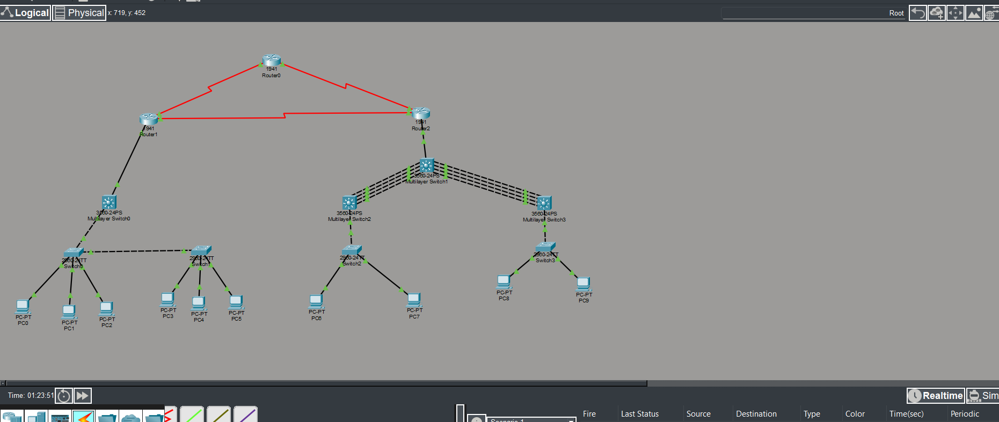

## Southern Africa Regional Backbone

A Cisco Packet Tracer project based on Southern Africa Logistics’
regional network, connecting Maseru Headquarters with branches in
Botswana and Eswatini (Swaziland).

### Technologies covered
- Departmental VLAN segmentation and IPv4 subnetting
- Router-on-a-stick inter-VLAN routing
- VTP server and client configuration
- Trunking with restricted allowed VLANs
- Four-link LACP EtherChannels
- Rapid-PVST and primary root bridge selection
- Single-area OSPF using process ID 15
- Passive OSPF LAN interfaces

### Opening the lab
Download the project’s .pkt file and open it in Cisco Packet Tracer.

### Project background
Developed as part of my Scaling Networks coursework at Botho University.

### Connectivity verification

Successfully tested connectivity from PC0 in Botswana to PC9
in Eswatini at 192.168.15.195. All four ICMP echo requests
received replies, with 0% packet loss. Packet Tracer also
reported a successful ICMP PDU from PC0 to PC9.

